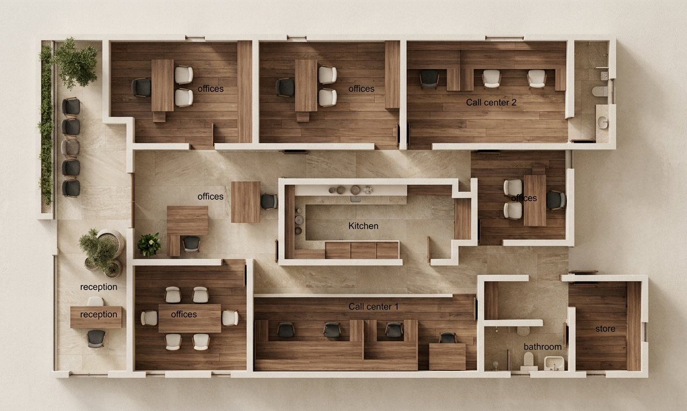

# ArchiDream ✦

**Blueprint → dream home.** Upload a DXF floor plan, pick an interior style, and
get a photoreal stylized top-down view with clickable rooms, step inside any room
in 360°, and generate a marketing tour video, all grounded in the drawing's real
geometry, so nothing drifts from the actual plan.

**▶ [Watch the 3-minute demo](REPLACE_WITH_YOUTUBE_LINK)** &nbsp;·&nbsp; **[Live project page ↗](https://dhrumil59.github.io/ArchiDream/)**

[](REPLACE_WITH_YOUTUBE_LINK)

---

## 🏆 Challenge theme

**July Challenge - Reimagine Creative Industries with AI** (theme: *Creative Industries*).

ArchiDream is an AI-powered design and visual-storytelling tool for architecture and
real estate. It targets the challenge head-on: **AI as a creative *partner*, not just a
content generator**, and closing **the gap between imagination and execution**. An
architect's DXF is precise but emotionally dead; ArchiDream turns it into a styled,
walkable, shareable experience in minutes - the kind of output that used to require a
3D artist and days of work. It maps directly onto the challenge's example solution
areas: *AI-powered design and visual concept tools*, *multimodal experiences*, and
*interactive media & storytelling*.

---

## 🎯 Problem statement

A property developer cannot get construction finance until roughly 70% of units are
pre-sold, and cannot pre-sell an apartment that does not physically exist without CGI. So
the marketing visuals sit on the critical path of the entire project.

Producing them is slow. Commissioning a studio to model the building and render photoreal
interiors, exteriors and a flythrough takes weeks to months, and every restyle is another
round. Meanwhile the clock is metered: a 90-day delay adds roughly $1.1M in interest carry
on a mid-sized project, holding costs run tens of thousands of dollars a month, and only
25% of developments finish within 10% of their deadline (KPMG Global Construction Survey).
Speed to market is not a nicety; it is margin.

**Why this matters:** off-plan property is sold before it is built, so it can only be
marketed through CGI, and lenders typically require around 70% pre-sales before releasing
construction finance ([Feasly](https://www.feasly.com.au/guides/off-the-plan-presales-requirements-australia-guide),
[Globe and Mail](https://www.theglobeandmail.com/business/article-condo-developers-big-banks-financing-threshold/)).
A 90-day delay adds roughly $1.1M in interest on a mid-sized project
([Finance Lobby](https://financelobby.com/cre-insights/real-estate-development-loan-rates-what-to-expect-and-how-to-prepare/)),
only 25% of projects hit their deadline (KPMG Global Construction Survey), and off-plan
already sells at a 10-15% discount to completed pricing.

---

## 💡 Solution

Upload a DXF and, in minutes, ArchiDream produces four things - each grounded in the
plan's **actual extracted geometry**:

1. **Styled top-down render** - a photoreal, furnished overhead view in one of four
   interior styles (Scandinavian · Japandi · Mediterranean · Dark-luxury), with
   **clickable room hotspots** placed pixel-perfectly from the real geometry.
2. **Step-inside 360° panoramas** - click any room to enter an equirectangular
   panorama in a drag-to-look sphere viewer. Generated one room at a time, on demand.
3. **Auto-directed marketing tour video** - one button compiles the styled plan and the
   room 360s into a narrated, deterministic MP4 promotional tour.
4. **Polygon region edit** - inside any 360° panorama, draw a freehand polygon over a
   region and describe the change ("a terracotta reading chair"). Qwen inpaints only the
   selected area while the rest of the image stays untouched.

No 3D reconstruction anywhere - it fuses **precise extracted geometry** with
**generative imagery** for interactivity. The geometry keeps the AI honest; the AI makes
the geometry beautiful.

---

## 🧠 AI approach & architecture

The guiding principle throughout: **geometry is ground truth, AI is the creative skin -
the LLM decides, deterministic code executes.**

```
                        ┌─────────────────────────────────────────────┐
   DXF floor plan ─────►│  Deterministic extraction engine (no AI)    │
                        │  dxf_analyse.py → model.json                │
                        │  rooms, walls, openings, furniture (meters) │
                        └──────────────────┬──────────────────────────┘
                                           │  exact meters → pixel transform
                                           │  planrender.py → plan_transform.json
                                           ▼
                    plan.png  +  rooms.json (pixel polygons = SVG hotspots)
                                           │
        ┌──────────────────────────────────┼──────────────────────────────────┐
        ▼                                  ▼                                  ▼
  ① Image AI: stylize top-down      ② Image AI: per-room 360           ③ IBM Granite
  Gemini 3 Pro Image (Nano Banana)  equirect pano, fact-grounded        ibm/granite-4-h-small
  / Qwen - camera-locked, prompt    from room dims / openings /         via watsonx.ai →
  grounded in extracted room facts  daylight direction / furniture      shot-plan JSON
        │                                  │                                  │
        ▼                                  ▼                                  ▼
  stylized/{style}@{model}.png      panos/{style}@{model}/{room}.png    compile_tour.py
  (same canvas → hotspots align)    (sphere viewer)                     → index.html (GSAP)
                                           │                                  │
                                           ▼                                  ▼
                                  ④ Polygon region edit              npm run render
                                  draw polygon on flat pano          HyperFrames → MP4
                                  → Qwen inpaints masked region      tours/{style}@{model}.mp4
                                  → pano updated in-place
```

### The layers of the approach

**1. Deterministic geometry (ground truth)**

`backend/engine/dxf_analyse.py` parses any DXF into a semantic `model.json` - every
room (as a closed polygon), wall, opening (door/window), and movable furniture item
in real-world **meters**. No AI touches the measurements. This model is rendered to a
plan image by `planrender.py`, which pins the matplotlib axes to an exact
world-window so the pixel↔world mapping is a pure linear transform persisted to
`plan_transform.json`. `meters_to_px()` converts that transform into pixel hotspot
positions - which is why room hotspots land pixel-perfectly on top of the
AI-generated art even though the AI never sees the coordinates.

**2. Fact-grounded image generation**

Every AI image call is built from geometry-derived facts, not generic descriptions:

- *Stylize* - the prompt receives the full room inventory (room names + areas) and
  a strict camera lock: same orthographic top-down view, no added or removed walls.
- *Pano* - `room_brief()` derives a per-room fact string from `model.json`:
  room shape and dimensions in meters, furniture items with wall-relative placement
  (e.g. "sofa against the north wall"), door/window openings with compass side and
  width, and which sides receive natural daylight (from window positions). The model
  is instructed to *decorate without inventing architecture*.

Both Gemini 3 Pro Image ("Nano Banana") and Qwen `qwen-image-edit-plus` are supported
as image backends. The active model is selected per-request from a dropdown in the UI.

**3. LLM as director, not author**

For the marketing video, **IBM Granite `ibm/granite-4-h-small` (watsonx.ai `us-south`)**
acts as a creative *director*: one chat call returns a structured **shot-plan JSON**:

```json
{
  "order":    ["kitchen", "living-room", "bedroom-1"],
  "captions": {"kitchen": "Sun-drenched morning rituals", ...},
  "tagline":  "Mediterranean simplicity: sun-kissed living, timeless comfort"
}
```

`compile_tour.py` consumes that plan, sorts the rooms accordingly, stages the media,
and fills a `tour-template.tpl` → `index.html` HyperFrames composition with GSAP
animations. `npm run render` then renders it deterministically to MP4. The LLM makes
creative decisions; the render is 100% reproducible and costs no image-API calls.
Granite runs in a daemon thread with a 25s timeout; if it's unavailable the compiler
falls back to area-descending order with no captions.

**4. Polygon region edit (Qwen inpaint)**

In the PanoModal "edit" mode the user draws a freehand polygon by clicking on the flat
pano image. The SVG overlay uses `viewBox="0 0 4096 2048"` with
`preserveAspectRatio="xMidYMid meet"` - matching the `object-contain` letterboxing
exactly so click coordinates map precisely to pano pixels. On submit: the backend crops
the polygon's padded bounding box, calls `_qwen_generate()` with an instruction prompt,
then pastes the edited crop back through a feathered polygon mask so only the selection
changes. The pano file is overwritten in-place; a cache-bust `?t=` query string forces
the sphere viewer to reload.

**Stack:** FastAPI (Python) backend · Next.js 15 + Tailwind + three.js frontend ·
Gemini 3 Pro Image / Qwen for imagery · Qwen `qwen-image-edit-plus` for region inpainting ·
**IBM Granite `ibm/granite-4-h-small` (watsonx.ai)** for video direction ·
HyperFrames for deterministic video rendering.

---

## 🗂️ Data layout

One folder per project under `ArchiDream/data/<pid>/`:

```
data/<pid>/
├── source.dxf                          uploaded drawing
├── model.json                          semantic model (rooms/walls/openings/furniture, meters)
├── plan.png                            deterministic DXF render (1600px wide)
├── plan_transform.json                 world↔pixel mapping for plan.png
├── rooms.json                          per-room pixel polygons + centroids for the UI
├── project.json                        id, name, dimensions
├── stylized/
│   ├── scandinavian@nano-banana.png    real result
│   └── scandinavian@nano-banana.mock.png  placeholder (never served as result)
├── crops/
│   └── scandinavian@nano-banana/
│       └── <room_id>.png              room crop fed to the pano call
├── panos/
│   └── scandinavian@nano-banana/
│       └── <room_id>.png              4096×2048 equirect 360
└── tours/
    └── scandinavian@nano-banana.mp4   rendered tour video
```

**Cache key = `{style}@{model}`.** Every AI output is keyed to both the style and the
image model. Switching either triggers a new generation while all existing outputs
persist. Legacy files generated before the model dropdown (named just `{style}.png`)
are transparently aliased to `{style}@nano-banana` on read.

Mock results (watermarked placeholders produced when no API key is set) are saved
under a `.mock.png` suffix and are **never served as real results** - so adding a key
later immediately triggers a fresh real generation without clearing the cache manually.

---

## 🤖 How IBM Bob was used

**IBM Bob was the primary development tool** for ArchiDream - the AI dev assistant that
built the application through spec-driven, AI-assisted development, using its
**Ask → Plan → Code** workflow:

- **Ask / explore** - ArchiDream sits on top of an unfamiliar CAD/DXF codebase. Bob was
  used to understand the existing geometry engine and data model before extending it,
  rather than reverse-engineering it by hand.
- **Plan** - before each feature (the meters→pixel hotspot transform, the fact-grounded
  prompt system, the per-room 360 flow, the Granite-directed video pipeline, the polygon
  region edit), Bob generated an implementation plan that was reviewed and refined first,
  then executed.
- **Code** - features were built incrementally with Bob writing and wiring the backend
  endpoints, the Next.js UI, the prompt engineering, and the video compiler - followed by
  tight *"check for bugs"* review-and-fix loops after each phase.

The result is that the AI-assisted workflow itself mirrors the product's philosophy:
plan deliberately, then let deterministic code execute - with AI as the partner
throughout, not a black-box generator.

---

## ▶️ Run it

### Prerequisites

- Python 3.11+
- Node.js 18+
- The `ibm-watsonx-ai` SDK requires the project to be in the **`us-south`** region
  (model `ibm/granite-4-h-small` is only available there)

### Backend

```bash
cd ArchiDream/backend
python -m venv .venv
.venv\Scripts\activate          # Windows
# source .venv/bin/activate     # macOS / Linux
pip install -r requirements.txt
python -m uvicorn app:app --port 8000
```

### Frontend

The Next.js dev server proxies `/api/*` and `/data/*` to `localhost:8000`
(configured in `next.config.mjs`), so you only need two terminals.

```bash
cd ArchiDream/frontend
npm install
npm run dev        # → http://localhost:3000
```

### Demo data

Four sample DXFs ship in `samples/`. Pre-process them before the demo so the
first page-load doesn't wait on live DXF extraction:

```bash
cd ArchiDream/backend
python seed.py                                      # all DXFs in ../samples/
python seed.py ../samples/Simple-house.dxf --overlay   # + debug rooms overlay png
```

---

## 🔑 API keys

Without any key the app runs end-to-end in **preview mode** - every AI call returns
a watermarked placeholder image, and the tour compiles with a deterministic fallback
shot order. The whole flow is demoable offline. For real renders, copy `.env.example`
to `.env` in the `ArchiDream/` root and fill in:

```
GEMINI_API_KEY=your-key-from-aistudio.google.com   # Nano Banana image generation
DASHSCOPE_API_KEY=your-key                          # Qwen image model + region edit
WATSONX_API_KEY=your-ibm-cloud-key                  # IBM Granite video director
WATSONX_PROJECT_ID=your-watsonx-project-id          # us-south project
WATSONX_URL=https://us-south.ml.cloud.ibm.com
```

Optional: `NANO_MODEL` overrides the default image model
(`gemini-3-pro-image-preview`). `QWEN_IMAGE_MODEL` overrides the Qwen model
(`qwen-image-edit-plus-2025-12-15`).

The UI shows a **"preview mode"** badge next to the model selector when the active
model's key is absent, so it's always clear whether results are real or mocked.

---

## 🔌 Endpoints

| Method | Path | Body / params | What |
| --- | --- | --- | --- |
| POST | `/api/projects` | multipart `file` (.dxf) | Ingest DXF → project + rooms |
| GET | `/api/projects` | - | List all projects |
| GET | `/api/projects/{id}` | - | Project state: stylized URLs, pano URLs, tour URLs |
| POST | `/api/projects/{id}/stylize` | `{style, model}` | Stylized top-down render (cached) |
| POST | `/api/projects/{id}/rooms/{rid}/pano` | `{style, model, force}` | 360 pano (cached; `force` bypasses cache) |
| POST | `/api/projects/{id}/rooms/{rid}/edit-region` | `{style, model, prompt, polygon}` | Polygon inpaint, pano overwritten in-place |
| POST | `/api/projects/{id}/tour-video` | `{style, model, rooms}` | Kick off async tour render |
| GET | `/api/projects/{id}/tour-video` | `?style=&model=` | Poll render: `{status, url, error}` |
| POST | `/api/styles` | `{name, colors, materials, …}` | Create custom style (persisted) |
| GET | `/api/styles` | - | All styles (built-in + custom) |
| GET | `/api/models` | - | Image models + availability flags |
| GET | `/api/health` | - | Server health + active provider |

**Styles:** `scandinavian` · `japandi` · `mediterranean` · `dark-luxury` · any custom id

**Tour video is async.** `POST /tour-video` returns immediately with
`{status: "rendering"}`. Poll `GET /tour-video?style=&model=` every few seconds;
it transitions to `{status: "done", url: "…"}` or `{status: "failed", error: "…"}`.
The frontend polls every 3 seconds automatically.

---

## 🎨 Custom styles

The "＋ New style" button in the style picker opens a modal where you define:
- Name, tagline, emoji
- Palette (≥2 `#rrggbb` colors)
- Materials list (≥1 entry)
- Vibe tags, accent color

Custom styles are validated and saved to `data/custom_styles.json` and are
immediately available in every dropdown and image call without a server restart.
Built-in style IDs (`scandinavian`, `japandi`, etc.) can never be shadowed.

---

## 📐 Layout-fidelity notes

- The stylized image is resized back to the plan render's **exact pixel size**
  (1600 px wide), and the prompt forbids moving or adding structure. Hotspots come
  from our extracted geometry, so minor AI drift in the image is tolerable.
- Neither Gemini nor Qwen offers a native 2:1 aspect preset. Gemini is asked for
  16:9; Qwen is asked for `2048*1024`. Both are resized to exactly 4096×2048
  equirect afterwards - a mild vertical stretch that is imperceptible in a sphere
  viewer.
- The pano prompt enforces mechanical equirectangular geometry: straight horizon at
  exact vertical midpoint, wrap-continuous left/right edges, all four walls visible
  across the full width.
- Cache keys are `{style}@{model}`. Switching style or model triggers a fresh
  generation; old results stay on disk. Delete
  `data/<project>/stylized|panos|tours` to force full regeneration.
